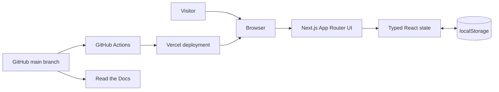
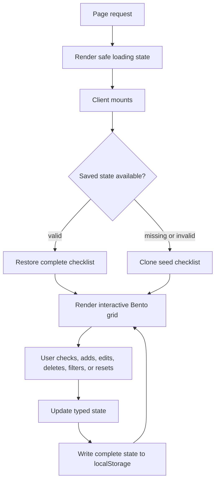

# Architecture

Household Catch-Up is a static-first Next.js application. It has no server-side
data store, authentication, API, or third-party runtime dependency.

## System view

## Checklist lifecycle

## Source layout

- `app/checklist-data.ts` defines the typed models, seed content, runtime
  validation, and safe seed cloning.
- `app/checklist.tsx` owns client hydration, persistence, and all checklist
  interactions.
- `app/globals.css` defines Tailwind theme variables and the responsive Bento
  presentation.
- `app/layout.tsx` defines metadata, Geist typography, theme colors, and the
  custom favicon.
- `.github/workflows/ci.yml` validates lint and production compilation on
  GitHub-hosted Node.js 22 runners.

## State and failure handling

The server and initial client render show the same loading card. Browser storage
is read only after mounting, avoiding hydration mismatches. Saved data must pass
shape, content, and identifier-uniqueness checks. Missing storage, invalid JSON,
invalid data, quota failures, and private-mode restrictions fall back to a
working in-memory seed without crashing.

Reset changes only each task's `completed` property. It deliberately preserves
section order, stable identifiers, edited text, added tasks, deleted tasks, and
the visibility preference.

## Security and privacy

No task content crosses the network. There is no authorization boundary because
all pages are public and no account data exists. Deployment credentials belong
only in Vercel or GitHub secret stores and are never exposed through `NEXT_PUBLIC`
variables.
