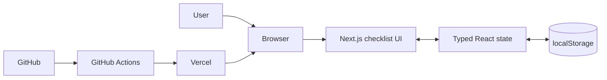

# Architecture

The application is a static-first Next.js App Router site. A client component
owns typed checklist state and persists it to browser `localStorage`; there is
no backend, account system, API, or database.

On the server and before client hydration, the page shows a safe loading card.
After mount, saved data is parsed and validated. Missing, malformed, or invalid
data falls back to a fresh copy of the seed checklist. Storage write failures do
not interrupt in-memory use.

Resetting maps over the current tasks and changes only `completed` to `false`,
so additions, text edits, deletions, identifiers, order, and filter preference
remain intact.

See the repository's
[full architecture document](https://github.com/levensailor/life-optimized/blob/main/ARCHITECTURE.md)
for the source layout, complete lifecycle, and privacy boundary.
